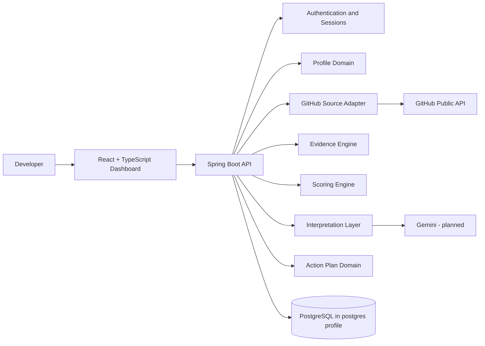

# Shadow Engineer
## Enterprise Project Status, Architecture, Gaps, and Delivery Plan

**Document status:** Current working baseline
**Date:** 2026-10-11
**Repository:** https://github.com/Ninjja17/Ghost
**Primary branch:** `main`
**Audience:** Product, engineering, architecture, security, and delivery stakeholders

---

## 1. Executive Summary

Shadow Engineer is an evidence-based developer growth platform. It is intended to analyze a developer's work, explain observable patterns, calculate transparent growth signals, and produce evidence-backed recommendations.

The project has progressed beyond a visual prototype. The local system now contains:

- A React dashboard and onboarding flow.
- A Spring Boot modular-monolith API.
- Email/password authentication with HttpOnly sessions.
- User-owned GitHub source connections.
- Repository snapshot persistence boundaries.
- Versioned evidence records.
- Deterministic Developer DNA score snapshots.
- Evidence-backed recommendations and mentor interpretations.
- Persisted four-week action-plan APIs.
- Unit tests for extraction, scoring, and interpretation.

The system is **not production complete**. The current production deployment path is unresolved. Railway deployment was paused after repeated configuration and database connection failures. The local application is the reliable reference environment.

### Current architectural position

```text
Authenticated User
        |
        v
GitHub Source Connection
        |
        v
Repository Snapshot
        |
        v
Evidence Records
        |
        v
Deterministic Scores
        |
        v
Recommendations + Mentor Interpretation
        |
        v
Unified Report API
        |
        v
React Dashboard + Action Plan
```

### Current delivery position

| Area | Status | Confidence |
|---|---|---:|
| Frontend product flow | Implemented locally | High |
| Backend API foundation | Implemented locally | High |
| Authentication | Functional prototype | Medium |
| GitHub public-source analysis | Functional locally, rate-limit sensitive | Medium |
| Evidence extraction | Basic deterministic version | High |
| Score calculation | Basic deterministic version | High |
| Mentor interpretation | Deterministic, evidence-linked version | High |
| Gemini interpretation | Not implemented | None |
| PostgreSQL local profile | Implemented and migration-ready | Medium |
| PostgreSQL cloud deployment | Not verified | Low |
| OAuth/private repositories | Not implemented | None |
| Production deployment | Not complete | Low |

---

## 2. Product Scope

### Product promise

> Help developers understand what their work is proving, where their evidence is weak, and what deliberate action should come next.

### Product principles

1. Observed facts must be separated from computed metrics.
2. Computed metrics must be deterministic and versioned.
3. AI interpretations must reference evidence IDs.
4. Confidence must be separate from skill strength.
5. Missing evidence must not be treated as negative evidence.
6. Career paths must be presented as scenarios, not guarantees.
7. Repository content is untrusted input.
8. A user must be able to correct, disconnect, export, and delete their data.

### Current beta scope

The first useful beta should focus on one loop:

```text
Create account
    -> Connect GitHub
    -> Collect repositories
    -> Extract evidence
    -> Calculate scores
    -> Explain findings
    -> Generate action plan
    -> Track completion
```

Deferred capabilities:

- LinkedIn and LeetCode integrations.
- Kafka and distributed service extraction.
- Complex multi-agent orchestration.
- Broad future-career prediction.
- Enterprise team surveillance or manager dashboards.

---

## 3. Current Architecture

### 3.1 System context



### 3.2 Runtime topology

#### Local default mode

```text
React Vite server :5173
        |
        v
Spring Boot API :8080
        |
        v
In-memory repositories
```

This mode is the current reliable development path. Data resets when the API restarts.

#### Local PostgreSQL mode

```text
React Vite :5173
        |
        v
Spring Boot API :8080
        |
        +--> PostgreSQL :5432
        +--> Redis :6379 (available, not yet used by analysis)
```

#### Intended production topology

```text
Vercel / static frontend
        |
        v
Public Spring Boot API
        |
        +--> Managed PostgreSQL
        +--> Managed Redis
        +--> GitHub OAuth/API
        +--> Gemini API
```

Production deployment is not currently certified. Railway was removed from the active workflow after database and artifact-path issues.

### 3.3 Backend module boundaries

| Module | Responsibility | Current state |
|---|---|---|
| `auth` | Registration, login, sessions, cookie authentication | Implemented |
| `profile` | User profile persistence and ownership | Implemented |
| `github` | Public GitHub fetch, source ownership, repository snapshots | Implemented basic version |
| `evidence` | Deterministic evidence extraction and retrieval | Implemented basic version |
| `analysis` | Deterministic score snapshots | Implemented basic version |
| `interpretation` | Recommendations and mentor insights | Implemented deterministic version |
| `action` | Four-week plan generation and status | Implemented API version |
| `report` | Unified profile/source/repository/evidence/score response | Implemented |
| `web` | Errors, request IDs, health, CORS | Implemented |

### 3.4 Dependency direction

```text
Web controllers
       |
       v
Application services
       |
       v
Repository interfaces
       |
       +--> In-memory adapters
       +--> JDBC/PostgreSQL adapters
```

This is a modular monolith. The repository interfaces are the main persistence boundary. Kafka and microservices should not be introduced until measured workload requires them.

---

## 4. Delivered Capabilities

### 4.1 Frontend

- React + TypeScript + Vite application.
- Editorial data-oriented Shadow Engineer visual system.
- Onboarding profile form.
- Source-required empty state.
- Dashboard overview.
- Evidence Ledger view.
- Career Trajectory view.
- Mentor Council view.
- 30-day mission modal.
- Loading, error, empty, and responsive states.
- GitHub connection modal.
- Search, notification, mission, refresh, and mentor-to-mission interactions.
- Frontend build verified with `npm run build`.

### 4.2 Authentication

- Email/password registration.
- BCrypt password hashing.
- Expiring opaque sessions.
- Session hashes rather than raw token persistence.
- HttpOnly cookie delivery.
- SameSite and Secure cookie configuration.
- Authenticated `/me` endpoints.
- Profile ownership checks.
- Duplicate email and unauthorized error responses.

### 4.3 GitHub source

- Backend GitHub public profile fetch.
- Repository collection with pagination limit of 100.
- Public account ID persistence boundary.
- User-owned source connection.
- Source lookup and disconnect endpoints.
- Repository metadata persistence boundary.
- Rate-limit error handling.

### 4.4 Evidence and scoring

Current deterministic evidence types:

- Public repository count.
- Active repository count.
- Total repository stars.
- Language signals.

Current deterministic score dimensions:

- Builder.
- Finisher.
- Learner.
- Architect.
- Collaborator.

Every evidence record includes:

- User ID.
- Connection ID.
- Evidence type.
- Human-readable claim.
- Value.
- Confidence.
- Extractor version.
- Observation timestamp.

Every score snapshot includes:

- Score values.
- Formula version.
- User ID.
- Connection ID.
- Observation timestamp.

### 4.5 Interpretation

The current interpretation layer is deterministic and structured. It returns:

- Recommendations.
- Four mentor lenses.
- Confidence.
- Uncertainty.
- Evidence IDs.
- A version identifier.

This is deliberately implemented before Gemini so model output can be compared against a stable contract.

### 4.6 Action plans

- Four-week plan generation.
- Weekly titles and details.
- Completion criteria.
- User-owned status updates.
- `pending`, `in_progress`, `completed`, and `skipped` states.
- In-memory and PostgreSQL repository boundaries.

---

## 5. What Is Working Well

### Architecture

- The system has a clear dependency direction.
- Domain modules are separated inside a modular monolith.
- Persistence adapters are replaceable through repository interfaces.
- The evidence-to-score-to-interpretation sequence is now explicit.
- Migrations are versioned through Flyway.

### Product

- The concept has a clear emotional and product narrative.
- The source-required state prevents fabricated reports before data exists.
- The Evidence Ledger makes conclusions explainable.
- The Mentor Council has distinct lenses instead of one generic assistant response.
- Action plans have completion criteria rather than vague learning advice.

### Quality

- Frontend production builds pass.
- Backend tests pass.
- Evidence extraction has deterministic coverage.
- Score formulas have deterministic coverage.
- Interpretation has evidence-reference coverage.
- API errors include request IDs.

---

## 6. Current Failures and Gaps

### 6.1 Production deployment

**Failure:** Railway deployments repeatedly failed because the service mixed Dockerfile and Maven start behavior, then PostgreSQL was configured with a `localhost:5432` fallback in a cloud container.

**Impact:** The production API did not start reliably.

**Decision:** Railway is paused. Local development is the current reference environment.

**Resolution path:** Use one deployment strategy, connect a managed PostgreSQL service, verify migrations, then certify the public API before reconnecting Vercel.

### 6.2 GitHub integration

**Current limitation:** The system uses public username/API preview behavior rather than GitHub OAuth.

**Missing:**

- OAuth callback.
- Private repository permissions.
- Secure token storage.
- Source sync jobs.
- Incremental sync.
- GitHub rate-limit resilience beyond basic errors.
- Pull requests, reviews, commits, releases, README, and deployment evidence.

### 6.3 Persistence

**Current limitation:** Default local mode uses in-memory repositories.

**Impact:** Restarting the API clears users, sessions, sources, evidence, scores, and action plans.

**Resolution:** Use PostgreSQL mode with a verified managed database and run all Flyway migrations successfully.

### 6.4 AI interpretation

**Current limitation:** Mentor interpretation is deterministic. Gemini is not connected.

**Impact:** The product does not yet provide model-generated synthesis, but it has a safer baseline contract.

**Resolution:** Add Gemini behind the existing structured interpretation API. Never allow free-form model text to bypass evidence validation.

### 6.5 Data quality

Current GitHub evidence is shallow. Repository count, language, stars, and update timestamps are insufficient for strong claims about:

- Finishing.
- Architecture.
- Collaboration.
- Testing quality.
- Deployment skill.
- User impact.

The dashboard must label these as proxies until richer evidence is collected.

### 6.6 Security and privacy

Still missing:

- Account deletion.
- Data export.
- Source revocation audit.
- Secret detection/redaction.
- Repository prompt-injection defenses.
- Automated authorization tests.
- Production secret management.
- Formal privacy policy and retention rules.

---

## 7. Root Causes of Earlier Delivery Problems

1. UI features were built before the evidence and persistence contracts were stable.
2. Deterministic mentor mockups appeared before the report API existed.
3. Deployment configuration mixed Dockerfile and native Maven assumptions.
4. Cloud PostgreSQL was enabled without a verified database connection.
5. The frontend defaulted to local API assumptions in production until `VITE_API_URL` was configured.
6. Public GitHub API limits made live verification unreliable.

### Corrective operating rule

No new presentation layer should be added until its backend data contract, persistence path, and deterministic test exist.

---

## 8. Next Delivery Plan

### Gate 1: Local end-to-end stability

- [x] Start frontend and backend locally.
- [x] Register a user.
- [x] Connect a public GitHub source.
- [x] Extract evidence.
- [x] Calculate scores.
- [x] Generate interpretation.
- [x] Generate action plan.
- [ ] Add one automated API integration test for the full flow.

### Gate 2: Database reliability

- [ ] Start local PostgreSQL using Docker Compose.
- [ ] Run Flyway migrations V1 through V8.
- [ ] Verify registration survives restart.
- [ ] Verify source, repositories, evidence, scores, and action plans survive restart.
- [ ] Add database integration tests.

### Gate 3: GitHub OAuth

- [ ] Register GitHub OAuth application.
- [ ] Implement callback and state validation.
- [ ] Encrypt access tokens.
- [ ] Store scopes and expiration metadata.
- [ ] Add private repository consent.
- [ ] Replace anonymous username connection in production.

### Gate 4: Rich evidence

- [ ] Collect commits.
- [ ] Collect pull requests and reviews.
- [ ] Collect releases and topics.
- [ ] Inspect README and project structure safely.
- [ ] Detect tests, Docker, CI/CD, cloud, API, database, and documentation signals.
- [ ] Store evidence provenance for each claim.
- [ ] Add missing-data semantics.

### Gate 5: Gemini interpretation

- [ ] Add Gemini client with timeout and retry.
- [ ] Send only summarized evidence and score snapshots.
- [ ] Require strict JSON schema.
- [ ] Validate every evidence ID.
- [ ] Store model and prompt versions.
- [ ] Fall back to deterministic interpretation on failure.
- [ ] Add LLM-as-judge checks for grounding and usefulness.

### Gate 6: Product completion

- [ ] Connect action-plan UI to the action-plan API.
- [ ] Add completion and progress snapshots.
- [ ] Add user corrections to evidence.
- [ ] Add career scenarios using verified evidence gaps.
- [ ] Add resume ingestion after GitHub is stable.

### Gate 7: Production release

- [ ] Choose one backend host.
- [ ] Connect managed PostgreSQL.
- [ ] Configure production CORS and cookies.
- [ ] Verify health and readiness endpoints.
- [ ] Verify migrations in staging.
- [ ] Configure backups and monitoring.
- [ ] Add CI/CD.
- [ ] Run complete user-flow smoke test.

---

## 9. Definition of Production Readiness

The product is not production-ready until all of these are true:

- A user can register and log in after an API restart.
- Database migrations complete in the deployed environment.
- A user can connect and disconnect GitHub securely.
- A GitHub source belongs only to the authenticated user.
- Repository, evidence, scores, interpretations, and actions persist.
- Every report claim has evidence or an uncertainty label.
- Gemini failures fall back safely.
- Account and source deletion work.
- CORS and HttpOnly cookies work from the production frontend.
- The full flow passes in staging without manual database edits.

---

## 10. Operational Commands

### Frontend

```powershell
npm run build
npm run dev
```

### Backend without database

```powershell
cd backend
Remove-Item Env:SPRING_PROFILES_ACTIVE -ErrorAction SilentlyContinue
mvn spring-boot:run
```

### Backend with local PostgreSQL

```powershell
cd backend
docker compose up -d postgres redis
$env:SPRING_PROFILES_ACTIVE = "postgres"
mvn spring-boot:run
```

### Backend tests

```powershell
cd backend
mvn test
```

### Health checks

```text
GET http://localhost:8080/api/v1/health
GET http://localhost:8080/api/v1/ready
```

---

## 11. Key API Surface

| Endpoint | Purpose | Authentication |
|---|---|---|
| `POST /api/v1/auth/register` | Create account and profile | Public |
| `POST /api/v1/auth/login` | Start session | Public |
| `GET /api/v1/auth/me` | Restore current user | Required |
| `POST /api/v1/auth/logout` | End session | Required |
| `POST /api/v1/sources/github/connect` | Connect public GitHub source | Required |
| `GET /api/v1/sources/github/connection` | Read connected source | Required |
| `DELETE /api/v1/sources/github/connection` | Disconnect source | Required |
| `GET /api/v1/sources/github/repositories` | Read stored repositories | Required |
| `GET /api/v1/analysis/evidence` | Read evidence records | Required |
| `GET /api/v1/analysis/scores` | Read score snapshot | Required |
| `GET /api/v1/report` | Read unified report | Required |
| `GET /api/v1/report/interpretation` | Read recommendations and mentors | Required |
| `GET /api/v1/action-plan` | Read action plan | Required |
| `POST /api/v1/action-plan/generate` | Generate action plan | Required |
| `PATCH /api/v1/action-plan/{id}/status` | Update task status | Required |

---

## 12. Architecture Decisions

### ADR-001: Modular monolith first

**Decision:** Keep the backend as a Spring Boot modular monolith.

**Reason:** The product has not yet proven service boundaries or workload requiring Kafka/microservices. Modules are separated internally and can be extracted later.

### ADR-002: Deterministic analysis before LLM interpretation

**Decision:** Store evidence and calculate scores before calling Gemini.

**Reason:** This prevents the model from becoming the source of truth and makes interpretations testable.

### ADR-003: Evidence provenance is mandatory

**Decision:** Every recommendation and mentor insight carries evidence IDs.

**Reason:** Career guidance without traceability is difficult to trust and impossible to audit.

### ADR-004: Local in-memory mode remains available

**Decision:** Keep in-memory adapters for fast local development.

**Reason:** Developers can exercise the complete flow without requiring PostgreSQL or cloud credentials. Production must use PostgreSQL.

### ADR-005: Career outcomes are scenarios

**Decision:** Do not present future career paths as deterministic predictions.

**Reason:** Repository data is incomplete and career outcomes are inherently uncertain. The product should show evidence, confidence, gaps, and actions.

---

## 13. Executive Conclusion

Shadow Engineer has a credible local end-to-end foundation and a differentiated product direction. Its strongest asset is the evidence-to-action pipeline, not the visual dashboard or the mentor persona names.

The immediate priority is reliability:

```text
Local data flow
    -> PostgreSQL persistence
    -> GitHub OAuth
    -> Rich evidence
    -> Gemini interpretation
    -> Production deployment
```

The project should be judged as a **working local beta foundation**, not a complete production platform yet. The next release milestone is a stable staging environment where the entire user flow works without seeded data or manual database intervention.
